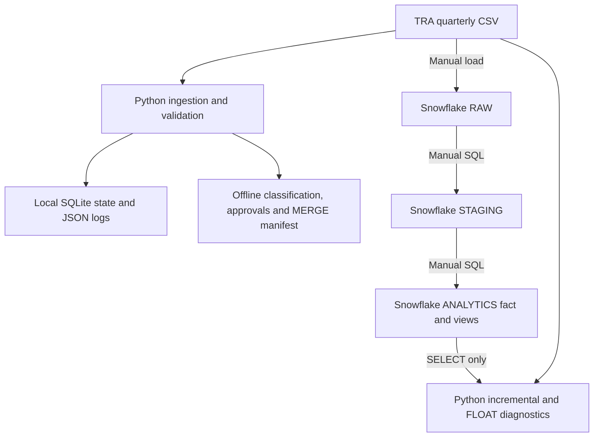

# End-to-End Oman Telecom Data Engineering Pipeline

Python, SQL and Snowflake engineering for quarterly telecom data, with validated
ingestion, a layered warehouse, incremental change detection and auditable batch control.

## Project Overview and Objectives

This project demonstrates how to preserve a source dataset, validate its structure
and values, model quarterly warehouse records, and assess future updates safely.
The focus is reproducible Data Engineering through modular code and explicit
data contracts, quality checks, lineage and recovery requirements.

The Snowflake warehouse follows a **manually executed SQL workflow**. Python
provides local ingestion, offline classification/planning and opt-in live
read-only comparisons. **Automatic incremental Snowflake MERGE execution and
scheduling are not implemented.** Offline publication plans retain
`publication_allowed=false`.

## Tech Stack

| Technology | Role |
| --- | --- |
| Python 3.11 and Pandas | Modular ingestion, validation and data handling |
| SQL and Snowflake | RAW, STAGING and ANALYTICS warehouse layers |
| Snowflake Python Connector | Environment-configured, opt-in read-only access |
| SQLite | Local ingestion history, batch checkpoints and revision decisions |
| Decimal and hashlib | Canonical numeric comparison and source/payload identity |
| OpenPyXL and Pytest | Excel ingestion and automated offline testing |
| Conda and VS Code | Dedicated development environment |

## Architecture and Data Flow



The offline planner has no warehouse execution path. Its canonical accepted-state
input and approvals are distinct from approximate read-only comparison results.

## Dataset Description and Provenance

The locally retained `data/raw/tra-open-data-traffic.csv` identifies Oman's
Telecommunications Regulatory Authority (TRA) in its metadata. It contains
aggregate traffic, broadband-consumption and internet-capacity measurements.

| Property | Inspected historical snapshot |
| --- | --- |
| Shape | 66 records and 9 columns |
| Periods | 2010 Q1 through 2026 Q2 |
| Business key | YEAR and QUARTER |
| Metrics | Seven nullable measurements |
| Format | UTF-8 CSV, six metadata lines, English/Arabic headers and an empty separator row |
| Quality findings | No duplicate period keys; 84 missing metric cells |

The metadata declares 68 records, while parsing yields 66. The ingestion report
exposes this discrepancy. Missing measurements remain NULL and retain their
distinction from zero. The [official TRA traffic page](https://tra.gov.om/open-data/traffic?lang=ar)
links to an open-data license, but acquisition provenance for this exact local
export remains unverified. **The CSV is excluded from public commits.** See the
[dataset acquisition and attribution guide](data/raw/README.md) for the license,
evidence, expected format and unresolved reproducibility limits.
Exact columns, units and the historical source checksum are documented in the
[source inspection](docs/tra-source-inspection.md).

`tests/fixtures/synthetic_tra_incremental.csv` contains explicitly labeled,
invented engineering values. Against its synthetic baseline it yields one NEW,
one REVISED and one UNCHANGED quarter. Those expected counts apply to that test
baseline, and its values must stay outside real warehouse publication.

## Repository Structure

```text
telecom-data-engineering/
├── config/warehouse_contract.json   # Confirmed objects, columns and evidence
├── data/raw/                       # Acquisition guide; local source CSV ignored
├── telecom_pipeline/               # Ingestion, comparison and planning modules
├── sql/analytics/                  # Historical fact/view SQL and reconciliation
├── sql/                            # Manual RAW setup and preserved legacy scripts
├── tests/fixtures/                 # Intentional synthetic CSV
├── tests/                          # Offline regression and mocked integration tests
├── docs/                           # Design decisions, runbooks and verification
├── requirements.txt                # Core ingestion and test dependencies
├── requirements-snowflake.txt      # Core dependencies plus Snowflake connector
├── pytest.ini
├── .env.example                    # Variable reference, without credentials
└── .gitignore                      # Local state, caches and secret-file exclusions
```

Generated ingestion databases, processed exports and local validation reports are
ignored. Historical SQL scripts retain their existing paths and review context.

Browse the [documentation index](docs/README.md) for current guides, design
proposals and archived reports. The [SQL index](docs/sql-index.md) explains the
purpose and execution scope of all twelve scripts.

## Data Ingestion, Validation, Transformation, and Snowflake Analytics

The shared readers support TRA/plain CSV and literal-cell XLSX. Validation checks
column structure, required keys, numeric types, nonnegative finite metrics and
duplicates. Strict decoding preserves Arabic text. SHA-256 identifies source
bytes, and the local pipeline records execution history and structured events.
See the [ingestion guide](docs/phase2-ingestion.md).

Local transformations preserve Decimal values and derive quarter dates. That
module retains earlier `NUMBER(38,6)` checks and legacy aliases. The confirmed
Snowflake contract instead records nullable FLOAT metrics in STAGING and the fact.

| Confirmed Snowflake object | Responsibility |
| --- | --- |
| `TELECOM_DB.RAW.TRA_TRAFFIC_SOURCE` | Nine VARCHAR source fields |
| `TELECOM_DB.STAGING.TRA_TRAFFIC_CLEAN` | Standardized keys and seven FLOAT metrics |
| `TELECOM_DB.ANALYTICS.FACT_TELECOM_QUARTERLY` | Quarterly metrics, quarter date and lineage |
| `TELECOM_DB.ANALYTICS.VW_YEARLY_TELECOM_SUMMARY` | Year/quarter coverage and Q4 capacity |
| `TELECOM_DB.ANALYTICS.VW_TELECOM_DATA_COVERAGE` | Per-metric observed/NULL coverage |

The contract includes maintainer-supplied DESCRIBE evidence. View result types and
nullability still need live confirmation. Historical Analytics loading SQL
preserves the validated 66-period snapshot. Review each script before manual
execution. Legacy RAW/OPS/MART scripts and `snowflake_loader.py` remain historical
references and are excluded from the recommended workflow. Details are in the
[warehouse contract](docs/warehouse-contract.md).

## Incremental Change Detection and Batch Control

The classifier compares all seven canonical Decimal metrics using YEAR/QUARTER.
It supports FULL_SNAPSHOT and QUARTER_DELTA inputs, scope/continuity checks and
NEW, UNCHANGED, REVISED or CONFLICTING_DUPLICATE outcomes. NULL/value transitions
are revisions. Formatting-only changes compare equal.

The local batch registry persists deterministic intent IDs, source hashes,
attempts, timestamps, checkpoints and versioned reviewer decisions. Historical
revisions hold the whole batch for explicit approval. Retry/recovery checks fence
stale attempts and protect completed local state. Local completion records an
offline simulation. Read the [registry guide](docs/local-batch-registry.md) and
[incremental design](docs/incremental-loading-design.md).

## FLOAT Precision Validation and Offline MERGE Planning

Snowflake FLOAT values can differ from exact source decimals. The existing live
comparison uses `Decimal(str(float))` as an approximate representation. The
precision assessor separately checks binary64 projection, exact binary expansion,
ULP distance, NULL consistency and range loss. Observed decimal formatting does
not establish authoritative source precision. No undocumented tolerance is enabled.
See the [precision policy](docs/float-precision-policy.md).

The offline MERGE planner produces deterministic JSON manifests for NEW inserts
and approved REVISED updates. It validates source identity, declared scope and
accepted-state hashes, preserves before-images and specifies transaction/rollback
requirements. It rejects approximate read-only approval contexts and unapproved
revisions. Publication remains disabled. The review procedure is documented in
the [MERGE planning guide](docs/offline-merge-planning.md).

## Setup and Installation

Run commands from the repository root. These examples use **Anaconda Prompt**.
Create the dedicated environment only if it does not already exist:

```bat
conda create --name telecom_de python=3.11 pip
```

Activate it and install dependencies for the full offline suite and optional
Snowflake reads:

```bat
conda activate telecom_de
python -m pip install -r requirements-snowflake.txt
```

`requirements-snowflake.txt` includes the core requirements. Some offline tests
import the connector while mocking connections. Core ingestion alone can use
`requirements.txt`. Configure VS Code to select your own `telecom_de` interpreter.

## Safe Offline Quickstart

The first four commands require a locally acquired TRA CSV at the expected path;
follow the [acquisition guide](data/raw/README.md) first. A fresh clone does not
contain that CSV. The synthetic-fixture test command works without it.

Inspect, ingest locally, transform, profile precision and test the synthetic scenario:

```bat
python -m telecom_pipeline.ingestion data/raw/tra-open-data-traffic.csv
python -m telecom_pipeline.pipeline data/raw/tra-open-data-traffic.csv --state-dir data/ingestion/quickstart
python -m telecom_pipeline.transformation data/raw/tra-open-data-traffic.csv
python -m telecom_pipeline.precision data/raw/tra-open-data-traffic.csv
python -m pytest tests/test_incremental_fixture.py -q -p no:cacheprovider --basetemp data/ingestion/fixture-tests-%RANDOM%-%RANDOM%
```

Ingestion and tests create ignored local state. The source CSV is read-only.
Repeated ingestion uses the local ledger to recognize existing normalized records.
Transformation without `--output` prints a summary, and profiling prints observed
formatting with authoritative precision fields left unresolved.

## Optional Live Read-Only Snowflake Validation

Use an existing working OAuth configuration and a granted TELECOM_READONLY role
with the required USAGE/SELECT access. Configure `SNOWFLAKE_ACCOUNT` and
`SNOWFLAKE_USER` privately in the same terminal. `.env.example` is a variable
reference and is not loaded automatically. Authentication requirements are in
the [authentication guide](docs/snowflake-authentication.md).

```bat
set "SNOWFLAKE_ROLE=TELECOM_READONLY"
set "SNOWFLAKE_AUTHENTICATOR=OAUTH_AUTHORIZATION_CODE"
set "SNOWFLAKE_WAREHOUSE=SNOWFLAKE_LEARNING_WH"
set "SNOWFLAKE_DATABASE=TELECOM_DB"
python -m telecom_pipeline.readonly_dry_run data/raw/tra-open-data-traffic.csv --input-mode FULL_SNAPSHOT --live-read-only --diagnostics
python -m telecom_pipeline.float_validation data/raw/tra-open-data-traffic.csv --live-read-only --diagnostics
```

The first command reports incremental classifications. FULL_SNAPSHOT must include
all accepted periods; genuine quarter-only updates use QUARTER_DELTA. The second
checks existing FLOAT projections and reports representative values and all
unexplained differences. Live commands require explicit opt-in and issue the
adapter's fixed SELECT. They do not approve or publish revisions. Reads may incur
warehouse compute costs. See the [comparison guide](docs/snowflake-readonly-dry-run.md)
and [conversion-validation guide](docs/float-conversion-validation.md).

## Testing and Verified Results

**Last recorded full offline result — 363 passed in 6.08 seconds on 2026-11-16,
using `telecom_de`.** Coverage includes source integrity, classification, SQLite
transactions/recovery, approvals, precision boundaries, review manifests, mocked
Snowflake integration and CLI entry points. Recorded evidence is in the
[readiness assessment](docs/publication-readiness.md).

Run the offline suite with the live warehouse write test explicitly excluded:

The full suite requires the original local CSV. Source-dependent tests include
an exact historical checksum assertion; a newer export is not an equivalent
regression fixture. Full historical reproducibility from a public clone remains
unresolved until the exact snapshot's acquisition provenance is established.

```bat
python -m pytest tests --ignore=tests/test_snowflake_live.py -q -p no:cacheprovider --basetemp data/ingestion/offline-tests-%RANDOM%-%RANDOM%
```

Use a fresh test directory for each run. The 363-pass result is recorded evidence,
not a test run performed for this README revision. This revision checks supported
CLI interfaces and read-only offline commands. Historical manual warehouse
validation also recorded 66 periods and the source's 84 missing metric cells.
Live authentication, conversion and publication claims require their own retained
execution evidence.

## Current Limitations and Future Improvements

- Automatic incremental Snowflake MERGE execution and scheduling are not implemented.
- Publication requires approved precision/reconciliation rules, canonical accepted
  history, trusted source provenance and authenticated reviewer recording.
- The future publisher must reconcile all layers and audit/checkpoint state in
  one coordinated transaction, with tested idempotency and recovery.
- RAW and the fact have no declared primary/unique key. Future publication needs
  duplicate-key checks and coordination with other writers.
- Live view metadata, exact local CSV provenance and full publication recovery
  evidence remain open. Dependency versions use supported ranges rather than a lockfile.

The [publication-readiness checklist](docs/publication-readiness.md) tracks current
blockers. The [implementation plan](docs/automation-implementation-plan.md) documents
future work and its review boundaries.

## Software and Dataset Licensing

No software license is included in this repository.

Third-party TRA datasets are outside the software license and remain subject to
their own attribution and usage terms. See the [dataset licensing and provenance
guide](data/raw/README.md). The local `data/raw/tra-open-data-traffic.csv` remains
excluded from public commits while its exact acquisition provenance is unresolved.
