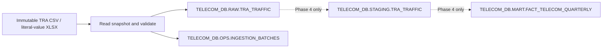

# Phase 3 — Snowflake integration, pending live verification

Target database: **TELECOM_DB**. Existing warehouse: **SNOWFLAKE_LEARNING_WH**.
Requested role: **ACCOUNTADMIN**. Authentication: **externalbrowser**.
The supplied account identifier and username were used only in process environment
variables for a read-only check attempt. Authentication failed before database
discovery with error 250001 / SQLSTATE 08001 and SAML/identity-provider indicators.
The user subsequently reported TELECOM_DB absent after a manual check; the Python
connector has not verified that finding. No cloud SQL was executed. CUSTOMERS is protected
by an explicit target guard in the Python configuration, renderer, and loader.

## Secure connection configuration

Use `telecom_de`. The approved local connector installation is version 5.2.0.
For another environment: `python -m pip install -r requirements-snowflake.txt`.
The optional requirements file keeps core local ingestion independent of cloud
dependencies. No password or private key is needed for browser authentication.

In a PowerShell terminal, set process environment variables:

```powershell
conda activate telecom_de
$env:SNOWFLAKE_ACCOUNT = Read-Host 'Snowflake organization-account identifier'
$env:SNOWFLAKE_USER = Read-Host 'Snowflake login username'
$env:SNOWFLAKE_ROLE = 'ACCOUNTADMIN'
$env:SNOWFLAKE_WAREHOUSE = 'SNOWFLAKE_LEARNING_WH'
$env:SNOWFLAKE_DATABASE = 'TELECOM_DB'
$env:SNOWFLAKE_AUTHENTICATOR = 'externalbrowser'
python -m telecom_pipeline.snowflake_check
```

The reference `.env.example` is not automatically loaded. Keep actual connection
settings in your process environment or secret manager. Never put passwords,
tokens, private keys, or actual credential files in Git. `.env*` files and common
private-key extensions are ignored. Client token caching is explicitly disabled
with `client_store_temporary_credential=False`. The Python connector supports browser SSO;
successful authentication still depends on your account/identity-provider setup.
See [official connection documentation](https://docs.snowflake.com/en/developer-guide/python-connector/python-connector-connect).

The discovery command authenticates without selecting a database first, then
executes only parameterized `SHOW DATABASES LIKE ...` and filters the result for
the exact name TELECOM_DB. Underscore wildcard matches are not mistaken for the
target. `exists: false` means not visible to this session/role, so visibility must
be considered before treating a missing result as definitive absence.
SSO opens a browser for you to authenticate. Do not send authentication tokens
or passwords in chat. The command does not create resources or load data.

## Approval before resource creation

If the exact-name check shows the database is absent, review this prepared SQL:

```sql
CREATE DATABASE IF NOT EXISTS TELECOM_DB;
```

It is stored in `sql/000_create_telecom_db.sql`. It has **not** been executed.
Ask for explicit approval before running this or the full setup script. Do not
interpret this documentation or a CLI flag as permission to modify cloud objects.

Render the complete setup locally for review, without connecting:

```powershell
python -m telecom_pipeline.snowflake_loader --database TELECOM_DB --render-sql 001_bootstrap.sql
```

Only after approval, run that rendered SQL in a Snowflake worksheet using the
approved account and role. It creates the database (if absent), four schemas,
two file formats, an internal stage, and four tables. It creates no warehouse,
role, user, grant, integration, external storage, or scheduled task.
All DDL uses `IF NOT EXISTS`; no replacement, deletion, or truncation is issued.
Existing definitions are left intact, not migrated. Inspect existing objects
before reuse; loading refuses incompatible RAW/OPS column layouts. Matching
column layouts alone do not establish ownership, so approve the exact targets.

## Warehouse design



| Layer | Contract |
| --- | --- |
| RAW | Nine exact source column names as nullable VARCHAR, plus file hash, parsed row ordinal, record hash, first batch, load timestamp |
| STAGING | Empty typed contract: year, quarter, seven numeric metrics, source/record identity and lineage |
| MART | Empty quarterly fact contract: period, quarter date, seven metrics and lineage |
| OPS | Batch UUID, source hash, UTC timestamps, status, expected/inserted/verified counts, quality report, sanitized error class |

The nine source columns are those verified in Phase 1, including the original
`Million Gb` labels. RAW preserves source strings such as `2,026.00`, decimal
precision, and nulls. It does not write Phase 2's normalized numeric payloads.
STAGING/MART use NUMBER(38,6), matching the inspected maximum fractional precision;
population and transformation rules are deferred to Phase 4.

RAW row ordinals start at 1 after metadata, bilingual headers, and empty rows are
excluded. They are parsed data-row numbers, not physical CSV line numbers.
Record identity is SHA-256 of `source_sha256:row_number`, so identical-file reruns
are insert-free and original duplicate data rows are preserved in RAW. A changed
file has a new identity and is retained as another snapshot. Cross-snapshot
business-key reconciliation belongs to later phases. This differs deliberately
from Phase 2's normalized observation deduplication.

The internal stage and CSV/JSON formats are prepared for future bulk loading;
this small snapshot uses one bound JSON payload in a set-based MERGE. The CSV
format is for prepared one-header exports, **not** the untouched bilingual TRA
file. No PUT/COPY is run by this loader, and no local file is uploaded to a stage.

## Loading and integrity verification

Offline plan (default, never connects):

```powershell
python -m telecom_pipeline.snowflake_loader
```

After resource setup AND explicit approval for loading RAW and updating OPS:

```powershell
python -m telecom_pipeline.snowflake_loader --execute-approved
python -m telecom_pipeline.snowflake_loader --execute-approved
```

The CLI checks environment configuration and database agreement, then acquires
a local writer lock. A connection preflight reads RAW/OPS column layouts before
any write. An OPS RUNNING record is inserted; an explicit transaction then merges
insert-only RAW records, fetches the target snapshot, and compares every record
identity, row ordinal, and cell value to the prepared source. Counts alone are
insufficient: missing/extra/duplicate rows or changed values roll back the load.
Success and RAW data commit together. Operational failures attempt a separate
FAILED audit update. A commit with uncertain outcome is marked UNKNOWN where
possible; audit failures can leave RUNNING history and must be investigated.
Connections and cursors close on completion. CLI errors/logs omit connector
exception text and secrets; API callers should also avoid logging raw exceptions.

Data values are bound parameters; SQL identifiers are validated. Metadata and
quality statistics are included in reports, with no credential dictionary.
JSON nulls are explicitly converted to SQL NULL by the MERGE projection.
See [official transaction guidance](https://docs.snowflake.com/en/sql-reference/transactions).

Run one writer per target across all machines. The local lock prevents duplicate
local CLI execution but is not a distributed lock, and direct `load()` API callers
must serialize their own calls. Standard Snowflake table uniqueness is not
enforced by primary keys; serialized MERGE and read-back validation provide the
documented rerun guarantees. See [Snowflake constraints](https://docs.snowflake.com/en/sql-reference/constraints).
After a hard interruption a lock file may remain in `data/ingestion`; confirm
that no loader process is active and review the OPS batch before manually removing
that specific stale lock. Do not automatically delete locks or restart unknown
writers. Large files require a future chunked/bulk strategy; this implementation
is sized for the actual small snapshot.

## Tests and monitoring

```powershell
python -m pytest -q
python -m pip check
```

Offline tests exercise configuration, approval guards, CUSTOMERS protection,
exact-name lookup, parameterized MERGE contracts, source integrity, read-back
verification, mocked reruns, rollback, redacted errors, and writer exclusion.
Mocks do not validate Snowflake SQL syntax or actual SSO/network behavior.

An optional live test exists but is skipped by default. Only after cloud-write
approval, configured credentials, and approved resource setup:

```powershell
$env:TELECOM_SNOWFLAKE_LIVE_APPROVED = '1'
python -m pytest tests/test_snowflake_live.py -v
Remove-Item Env:TELECOM_SNOWFLAKE_LIVE_APPROVED
```

The live test writes two OPS batches and loads/reruns the actual source. It does
not create objects or delete test data. Do not enable it for ordinary unit tests.
`sql/003_monitoring.sql` contains read-only count, duplicate, and history queries.
Render it with `--render-sql 003_monitoring.sql` before execution.

Current status and actual local results are in [Phase 3 verification](archive/phase3-verification.md).
Cloud integration remains unverified until the existence check, approved setup,
actual loading, and live integrity/rerun tests succeed. Phase 4 has not started.
